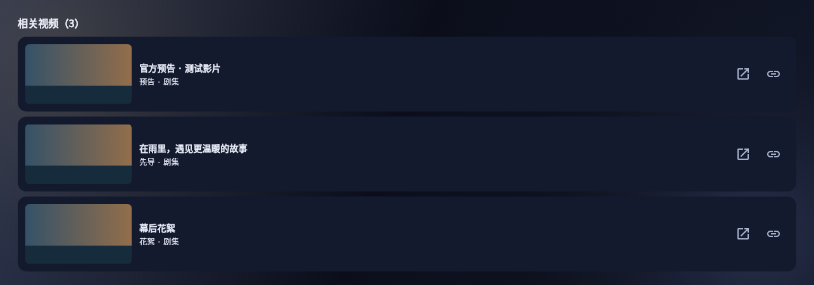
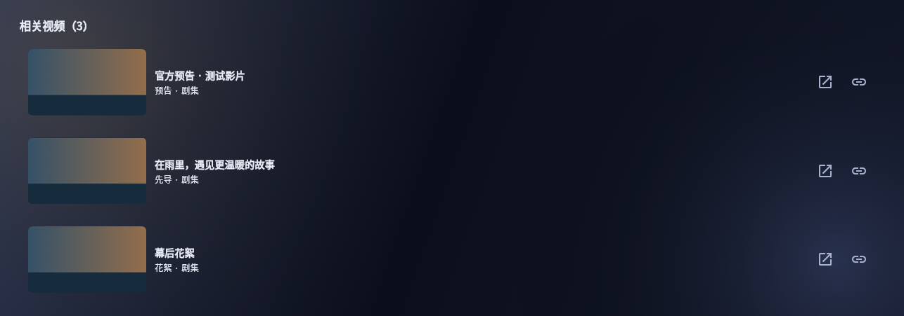
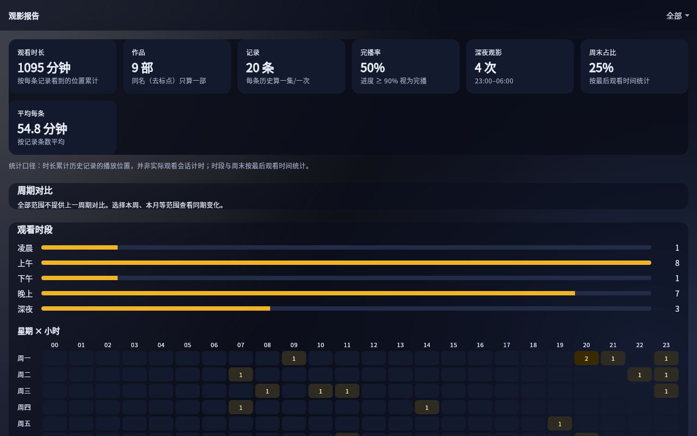
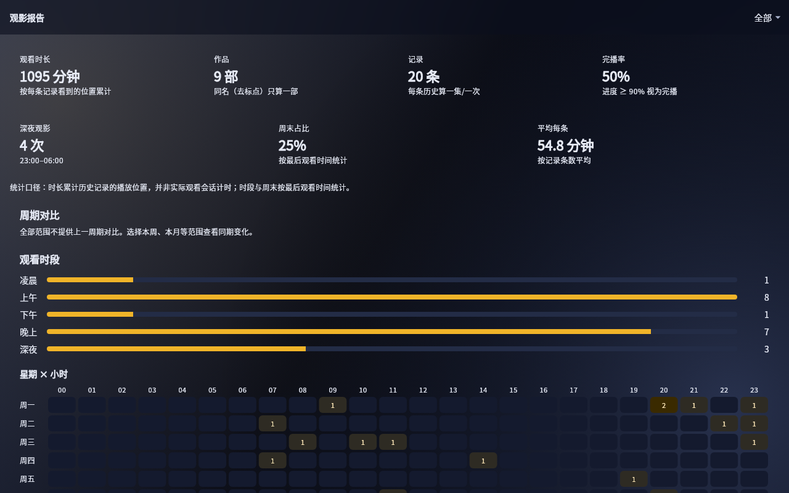
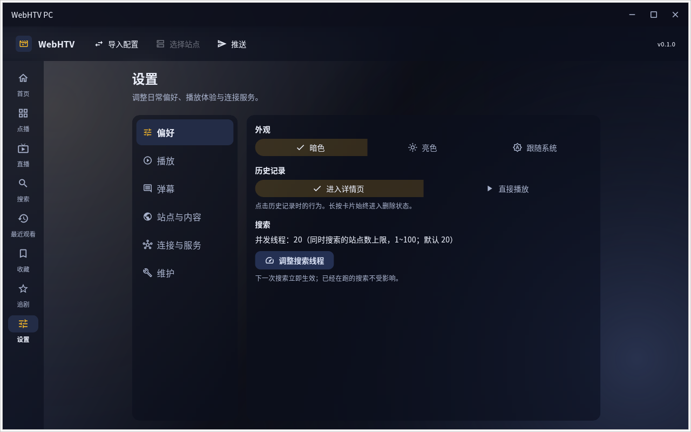
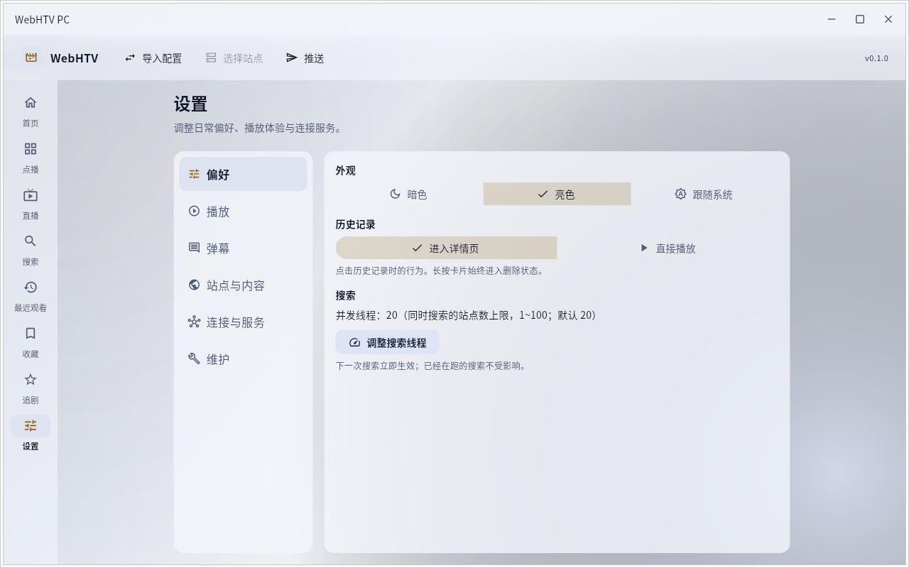
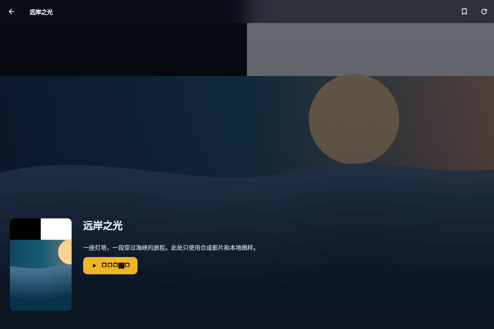
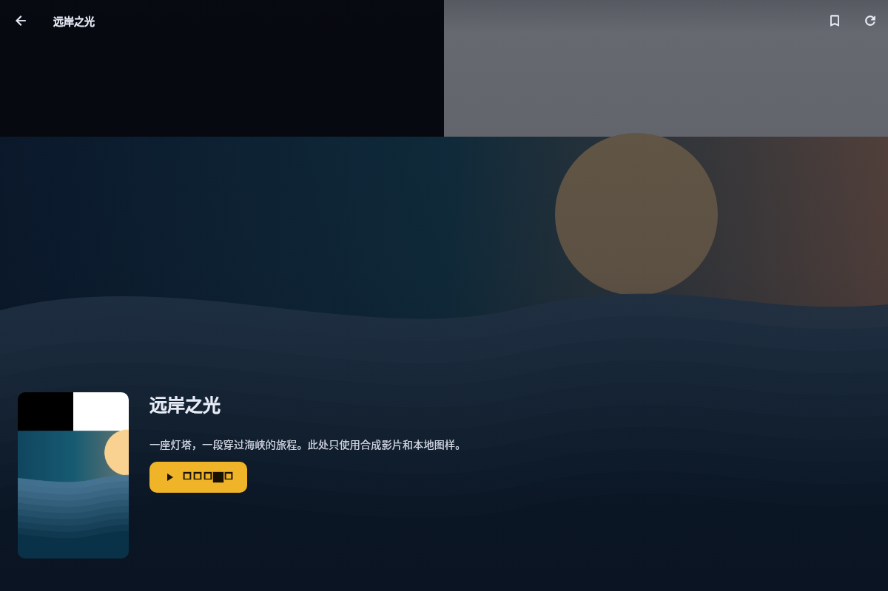

# 全应用无装饰边框与内容去底板验收

## 范围

本轮统一共享玻璃材质、顶栏/侧栏/浮层与键鼠反馈；内容页移除重复的大面积底板，保留海报、输入框、选择状态与真正浮层。没有改动片源协议与播放业务边界。

- 首页、点播、搜索、最近观看、收藏、追剧、直播及作品/人物详情，正文用标题、留白和对齐分组。
- 相关视频改为缩略图＋正文＋操作的透明条目，不再铺整行Card。
- 观影报告去分区/摘要卡底色，七项指标按宽度和文字缩放均衡换行；图表数据颜色、统计口径与AI调用行为保留。
- 搜索浮动标签、追剧焦点/悬停、首页大字号、直播刷新/节目单/大字行、播放器时间与键盘焦点、设置弹窗退场、推送长错误与无图详情回退按可复现问题修正。
- 启动通知独立占用空间，不再遮挡页面固定控件；关闭保留输入与滚动。长配置/站点名有界省略并保留完整提示。
- 修复主题偏好更新后MaterialApp不重建：亮色/暗色即时生效，跟随系统与重启恢复有真实根应用回归；播放器继续恒暗。

## 固定场景对照

### 相关视频：同三条夹具、1286×451、暗色

改前：

改后（缩略图/文字/按钮几何不变）：

### 观影报告：同历史与元数据夹具、1280×800、暗色

改前：

改后：

### 新Linux包：真实点击暗色→亮色

上两张为同包同隔离配置中切换，不能当成源码修复的Before/After；根应用失败回归另验证“选择light但MaterialApp仍dark”的旧故障。

### 后续收尾：详情顶栏与首页缓存

首页缓存改为后台恢复并复用稳定候选检查。固定夹具同步cache opens4→0、追加scan starts2→1、120全拒绝通知61→1；Lead独立25核心＋58风险回归通过，不能当作FPS提升比例。

两种详情顶栏去玻璃横条，保留向下渐隐遮罩。50项定向回归、4路径分析通过，独立Linux构建成功。两条路线明暗像素差异仅在顶部56px，最低文字对比度5.08:1，不是任意外部图片的保证。

## 已运行的验收

以下为功能开发阶段分批执行记录，部分套件重复，不能将数字相加当作互不重复的用例数：

| 阶段 | 结果 |
|---|---|
| 内容/详情/直播/搜索/通知合并验收 | 280次执行全通过；15路径静态检查无问题 |
| 相关视频局部收尾 | 108项风险回归＋亮色详情复测通过；真实hover/focus像素和Tab/Enter验证；分析干净 |
| 观影报告 | 127项UI/统计/元数据/AI/共享回归＋亮色共享报告复测通过；分析干净 |
| 真实根应用主题切换 | 设置/外壳/偏好74项、播放器19项通过，根主题/跨页/弹窗/系统/持久化再跑通过 |
| Linux打包与原生窗口 | 构建成功；八个入口/推送/报告路由分批烟测；实际暗亮切换、跨页及偏好文件验证；mapped AOT与新包一致 |

最终主题修复包AOT SHA256：`5a33f7767abd37ddd198ff22c732a46e51a7f81c0e7ddcdb78f02b966b767fb8`。这只是开发验收产物，不作为合并beta后发布包指纹。

## 验收边界

- 截图来自真实Flutter渲染或注明的Linux原生隔离窗口；无真实站源、详情与有结果数据使用固定fixture。
- 不触碰用户当前窗口、配置、历史；构建产物与临时配置不提交。
- Windows/macOS真机、任意外部壁纸对比度、真实站源播放及全部通知组合未实测；不将主题参数或fixture成功冒称全平台验证。
- 合入beta最新代码后的最终全量测试结果，以PR中文验收说明及CI为准。
- 设置共享滤镜和取消整页淡入实验未证实能修复本机菜单卡顿，已完整撤回，不在产品改动中。菜单延迟仍未解决，不宣称玻璃渲染实机性能已改善。
